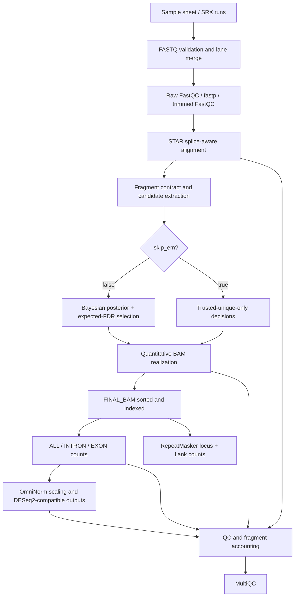

# mmRNAseq

**Fragment-aware, repeat-aware bulk RNA-seq analysis with Bayesian resolution of ambiguous genomic alignments.**

[Workflow](#workflow-at-a-glance) · [Multimapping model](#bayesian-multimapper-resolution) · [Counting](#gene-region-and-repeat-counting) · [Run](#quick-start) · [Outputs](#output-layout) · [References](#references)

mmRNAseq is a [Nextflow DSL2](https://www.nextflow.io/) workflow for short-read RNA sequencing. It combines STAR splice-aware genomic alignment, custom fragment-level multimapping inference, gene-region and RepeatMasker counting, normalization and an ordered, fragment-aware MultiQC report. The workflow retains selected, vendored modules derived from [nf-core/rnaseq](https://github.com/nf-core/rnaseq); its custom multimapper and counting path is distinct from the standard nf-core quantification workflow.

> **What the final BAM represents.** Every sample has one primary, sorted/indexed `FINAL_BAM` used for downstream counting. With `--skip_em false` (default), it contains trusted uniquely mapped fragments and multimappers hard-resolved under a Bayesian posterior expected-FDR rule. With `--skip_em true`, it contains trusted unique fragments only. Full-ambiguity and high-confidence diagnostic BAMs are generated and published **only** when `--save_align_intermeds true` (and high-confidence is omitted in unique-only mode).

> **Terminology.** Despite the legacy `--skip_em` option, the current resolver is **not an expectation–maximization algorithm**. It uses local unique-fragment density and alignment score evidence to calculate candidate posteriors, then makes hard fragment-level decisions. It does not iteratively update transcript/locus abundances using soft assignments.

## Why mmRNAseq?

Short reads often align to several loci—particularly paralogs, repetitive elements and transposable-element-rich sequence. Discarding these fragments loses information; selecting STAR's arbitrary primary alignment can introduce locus-specific bias. mmRNAseq makes genomic ambiguity explicit, estimates relative support for candidate locations, separates resolved and unresolved fragments, and tracks what ultimately enters counting. Locus-level resolution is limited by sequence information and model assumptions; ambiguous reads do not become uniquely identifiable merely because a posterior is computed.

## Workflow at a glance



**Core execution units:** samples are biological-library units; SRR runs belonging to the same SRX are technical sequencing runs, not independent biological replicates. Read counts, BAM alignment records and paired-end fragments are different units and must not be exchanged. For paired-end data, the intended multimapper observation is a **fragment/template** (normally two mates), not an individual SAM record.

## Bayesian multimapper resolution

The code is in `bin/mm_bayes_resolver.py`, with candidate generation in `bin/mm_build_candidates.awk` and SAM/BAM realization in `bin/mm_realize_bam.awk`.

### 1. Candidate/fragment contract

STAR emits candidate genomic alignments up to the configured multimapping ceiling (`--star_multimap_max`, default 500). mmRNAseq groups the SAM records by fragment, excludes unsupported or inconsistent fragment configurations, and records uniquely mapped fragments as **trusted anchors**. Each eligible multimapper has a set of candidate locations with genomic blocks, orientation, `AS` scores and candidate `HI` identifiers. Secondary-alignment flags are not interpreted as uniquely reliable placement evidence.

The method distinguishes *trusted unique*, *eligible multimapper*, and *excluded* at the fragment level before posterior inference. STAR's “too many loci” category is not silently treated as a set of observed candidates.

### 2. Local prior from unique-fragment density

For a genomic position, orientation group and candidate, the resolver estimates a local density from weighted unique-fragment anchors using a k-nearest-neighbour (kNN) mass window. The mass parameter **k is selected per sample and observed orientation** using deterministic leave-one-out likelihood; the selected mass, associated window scale and cross-validation curve appear in the QC outputs. A low-density background term stabilizes positions with sparse anchor evidence.

This local evidence is a model-dependent location prior/proxy, **not** a direct estimate of transcript abundance. The approach can favor already well-covered loci; it is not guaranteed to be unbiased across homologous copies, active repeats or paralogs.

### 3. Candidate posterior probabilities

For fragment $f$, candidate alignment $a$ and STAR alignment score $AS_{fa}$, the implemented score is

$$
\ell_{fa} = (AS_{fa}-\max_b AS_{fb})+\log D_{fa}, \qquad
P(a\mid f)=\frac{\exp(\ell_{fa})}{\sum_{b\in A_f}\exp(\ell_{fb})}.
$$

Here $D_{fa}$ is the local-density summary over the alignment's reference blocks. STAR scores enter as heuristic log-weights; they are not guaranteed to be calibrated log-likelihoods. The candidate with maximum posterior has $p_f^*=\max_a P(a\mid f)$, and modeled misassignment probability $e_f=1-p_f^*$. Computation is performed in fragment-complete chunks with vectorized NumPy; the algorithm does not split a fragment across processing chunks.

An additional **absolute alignment-quality gate** compares each candidate's normalized alignment score with a robust, orientation-specific distribution derived from trusted unique fragments. High posterior concentration alone cannot rescue an alignment that fails this gate.

### 4. Global posterior expected-FDR selection

Eligible fragments passing the absolute-score gate are ranked by increasing $e_f$. The selected subset is the largest prefix satisfying

$$
\widehat{\mathrm{FDR}}_{\mathrm{post}}(S)
=\frac{1}{|S|}\sum_{f\in S}(1-p_f^*)\leq\alpha,
$$

where $\alpha$ is `--mm_resolution_fdr` (default `0.05`). This is a *model-based expected false-assignment proportion* for the selected locations, not an experimentally calibrated frequentist FDR guarantee. Simulation, spike-ins or independent locus-specific assays are needed to assess calibration for a given genome and library.

The algorithm makes **hard assignments** for selected fragments rather than distributing read weight fractionally across all compatible loci. Nonselected eligible multimappers remain unresolved and do not enter quantitative counting.

### 5. Realizing the BAM

- **Quantitative `FINAL_BAM`:** trusted unique + selected FDR-resolved multimappers. The selected candidate retains both mates for paired-end data; secondary bit is cleared as appropriate, and the selected `NH`/`HI`, posterior-derived MAPQ, `ZR`, `ZP`, and original multiplicity `ZO` metadata are written by the realization code.
- **Full-ambiguity diagnostic BAM (optional):** contains selected, unresolved and excluded alignments, explicitly labeled for inspection; **not** appropriate as an ordinary one-fragment-one-count BAM.
- **High-confidence diagnostic BAM (optional):** trusted unique + resolved candidates with an additional per-fragment threshold $p_f^*\geq1-\alpha$. This is stricter than the global expected-FDR rule and must not be confused with the main quantitative set.

`--skip_em true` skips posterior resolution entirely: no multimapper is admitted into the final quantitative BAM. `--save_align_intermeds true` can still produce the full-ambiguity diagnostic BAM in this mode, but the redundant high-confidence BAM is omitted.

**Model limitations:** local unique-anchor density may be distorted by mappability, sequence composition, copy number, transcriptional hotspots and annotation incompleteness. Candidate truncation by STAR, missing alignments and variable insert/splice geometry affect the posterior. `ZP` encodes a model posterior for a selected candidate—not an empirical probability that the locus is truly correct.

## Gene-region and repeat counting

The quantitative BAM is the single input for downstream count generation. The `INTRON_EXON_COUNT` module uses custom gene-oriented transcript models prepared from the supplied GTF and `GenomicAlignments::summarizeOverlaps` with distinct overlap rules:

| Measurement | Overlap mode | Default |
|---|---|---|
| Gene/ALL | `Union` | On |
| Intron | `IntersectionNotEmpty` | On |
| Exon | `IntersectionStrict` | On |
| 5′ / 3′ UTR | `Union` | Off (`--count_utr true` to enable) |
| RepeatMasker annotations and flanks | Dedicated locus/strand-specific passes | On (`--count_repeats true`) |

These measurements are **not mathematically additive partitions**; they use distinct overlap criteria. In particular, exon plus intron counts need not equal ALL counts. Overlapping genes, antisense transcription, multi-overlapping loci and assignment choices affect interpretation.

RepeatMasker intervals and flanks are prepared **once per reference** by `PREP_REPEAT_ANNOTATION` and reused per sample. Keep FASTA, GTF and RepeatMasker coordinates on the **same genome assembly**, with consistent contig naming. Repeat counts remain subject to the mapping and hard-assignment limitations above; repeat family/subfamily and locus are different inference units.

## Normalization

`NORMALIZE_COUNTS_INTRON_EXON` merges per-sample counts and estimates sample scaling factors from the **ALL** gene matrix with the configured normalization. The same factors are then applied to the ALL, INTRON and EXON matrices:

$$
Y^{\mathrm{norm}}_{gs,r}=Y_{gs,r}\,c_s, \qquad c_s=1/\mathrm{sizeFactor}_s.
$$

Raw and normalized region matrices are written separately, including `Final_norm_count_mat.txt` for backward compatibility. When configured, DESeq2-compatible downstream objects and transformed-data QC plots are generated. Applying the ALL-derived scaling to introns and exons ensures a common reference across regions, but does not eliminate compositional confounding or justify modeling counts as independent across gene regions.

## Quick start

Requires Nextflow, a compatible Java runtime, a container runtime (Apptainer/Singularity is supported), FASTQ files or a supported public accession input, a genome FASTA and corresponding GTF/RepeatMasker annotations. The repository includes site-specific Slurm profiles; adapt their resource limits to your cluster.

```bash
export NXF_VER=25.10.9

nextflow run ./main.nf \
  --input samplesheet.csv \
  --fasta /refs/assembly.fa.gz \
  --gtf /refs/annotation.gtf \
  --rmsker /refs/repeatmasker.out.gz \
  --outdir /results/mmrnaseq_run \
  --skip_em false \
  --save_align_intermeds false \
  --nf_boost_cleanup false \
  -profile singularity \
  -c conf/ieo.slurm.config \
  -w /scratch/mmrnaseq/work \
  -resume
```

Always inspect your sample-sheet metadata (`strandedness`, biological sample vs technical sequencing run) and reference assembly before a run. In the samplesheet, identifiers `_R1`, `_R2` can be biological replicate names; do not infer replicate independence from string patterns alone.

For unique-only analysis, change to `--skip_em true`. For **additional BAM debugging**, use `--save_align_intermeds true`. This option replaces the obsolete `--save_mm_aux_bams` option; do not combine them. Final BAM publication is controlled separately by `--save_final_bam` (default true); this does not change the BAM used internally for counting.

**Caching:** use the same Nextflow `work/` directory and `-resume` when recovering from a failure. Avoid automatic nf-boost cleanup in resumed or regression-test runs; deleted work outputs cannot be reused even if published copies remain. Published `--outdir` is not the execution cache.

## Output layout

Default publication, omitting some optional tool-specific outputs:

```text
outdir/
├── fastqc/
│   ├── raw/                    # QC before trimming
│   └── trim/                   # QC after fastp
├── fastp/                      # fastp JSON, HTML and logs
├── star_salmon/
│   ├── log/                    # STAR alignment logs
│   ├── FINAL_BAM/
│   │   ├── SAMPLE.final.sorted.bam
│   │   └── SAMPLE.final.sorted.bam.bai
│   └── norm_deseq2_intron_exon/  # normalized region counts and diagnostic plots
├── qc/
│   ├── multimapper/           # merged model/fragment QC
│   └── samtools_quantitative/ # native alignment-record statistics; not fragment totals
├── multiqc/                   # ordered HTML summary
└── pipeline_info/             # versions / provenance
```

With `--save_align_intermeds true`, extra BAMs are published under `star_salmon/intermediate_bam/`, including `full_ambiguity/`, `high_confidence/` (when Bayesian resolution is enabled), and additional alignment/filtering products. Their generation and sorting cost are avoided by default where not needed for the main workflow.

The filename `SAMPLE.final.sorted.bam` is **identical across resolution modes**: record the corresponding `--skip_em`, `--mm_resolution_fdr` and reference parameters in your run metadata. The final BAM is the *final quantitative alignment*, not the raw STAR mapping output.

## Fragment-aware QC and MultiQC

MultiQC aggregates fastp, FastQC, STAR, multimapper contract/resolver/density/realization, RSeQC (when enabled), and normalization diagnostics. Report sections are configured in execution order. The main mapping statistics are expressed in **input/retained fragments**, not the number of aligned mates or SAM records.

The contract and realization stages check conservation relationships (for mapped candidates):

$$
N_{\rm contract}=N_{\rm trusted\ unique}+N_{\rm eligible\ multi}+N_{\rm excluded}
$$
$$
N_{\rm eligible\ multi}=N_{\rm resolved}+N_{\rm unresolved},\qquad
N_{\rm final}=N_{\rm trusted\ unique}+N_{\rm resolved}.
$$

In unique-only mode $N_{\rm resolved}=0$. *STAR-unmapped* and *not retained in the quantitative BAM* are distinct categories. Original PE singletons (one mate mapped) are not inferred by halving `samtools flagstat`; flagstat/idxstats/stats count alignment records with their own conventions and are retained as separate technical diagnostics. The main MultiQC report avoids presenting those record counts as fragments.

## Validation and reproducibility

Run `python -m pytest -q test/` in an environment with pytest and NumPy. The standalone `test/test_patch*.py` scripts additionally exercise known-answer contracts. These are not a substitute for matched HPC runs.

For every pipeline change, compare one baseline dataset with fixed FASTQs, GTF/FASTA, STAR settings, strandedness and RepeatMasker annotations. Test both `--skip_em false` and `--skip_em true`, and both `--save_align_intermeds false` and `true`. Critical comparisons: quantitative fragment names, chosen `HI` and `ZP` tags, sorted BAM content, gene/repeat counts, normalization factors and absolute MultiQC fragment totals. BAM publication switches must not change quantitative results or model QC.

**No claim of fully calibrated locus posterior probability or universal biological accuracy is made.** A scientifically credible benchmark requires simulations with known source loci and empirical validation across repeat classes, copy numbers and mappability regimes.

## Code organization

| Location | Responsibility |
|---|---|
| `workflows/rnaseq.nf` | Primary orchestration and fragment statistics |
| `subworkflows/local/bam_filter_em.nf` | Candidate, Bayesian/unique-only and realization flow |
| `bin/mm_build_candidates.awk` | Fragment-complete STAR candidate extraction |
| `bin/mm_bayes_resolver.py` | Local-density posterior and global expected-FDR inference |
| `bin/mm_realize_bam.awk` | BAM record selection, tags and realization QC |
| `modules/local/mm_bam_realize.nf` | Optional auxiliary BAM materialization |
| `bin/intron_exon_count.r` | Gene-region and repeat overlap counting |
| `bin/intron_exon_count_norm.r` | Normalization and matrix export |
| `assets/multiqc_config.yml` | MultiQC module/section order |
| `conf/modules.config` | Per-process resource arguments and publication policy |

## References

Cite the primary methods actually used in each analysis. These papers provide software/method context; **they are not claims that mmRNAseq's custom Bayesian resolver was published or externally validated in those papers**.

1. **STAR** — Dobin A. *et al.* STAR: ultrafast universal RNA-seq aligner. *Bioinformatics* **29**, 15–21 (2013). [doi:10.1093/bioinformatics/bts635](https://doi.org/10.1093/bioinformatics/bts635).
2. **fastp** — Chen S. *et al.* fastp: an ultra-fast all-in-one FASTQ preprocessor. *Bioinformatics* **34**, i884–i890 (2018). [doi:10.1093/bioinformatics/bty560](https://doi.org/10.1093/bioinformatics/bty560).
3. **SAM/BAM and samtools** — Li H. *et al.* The Sequence Alignment/Map format and SAMtools. *Bioinformatics* **25**, 2078–2079 (2009). [doi:10.1093/bioinformatics/btp352](https://doi.org/10.1093/bioinformatics/btp352).
4. **MultiQC** — Ewels P. *et al.* MultiQC: summarize analysis results for multiple tools and samples in a single report. *Bioinformatics* **32**, 3047–3048 (2016). [doi:10.1093/bioinformatics/btw354](https://doi.org/10.1093/bioinformatics/btw354).
5. **nf-core framework** — Ewels P.A. *et al.* The nf-core framework for community-curated bioinformatics pipelines. *Nature Biotechnology* **38**, 276–278 (2020). [doi:10.1038/s41587-020-0439-x](https://doi.org/10.1038/s41587-020-0439-x). Retained nf-core modules are acknowledged; mmRNAseq is not an official nf-core release.
6. **DESeq2** — Love M.I., Huber W. & Anders S. Moderated estimation of fold change and dispersion for RNA-seq data with DESeq2. *Genome Biology* **15**, 550 (2014). [doi:10.1186/s13059-014-0550-8](https://doi.org/10.1186/s13059-014-0550-8).
7. **Salmon (optional)** — Patro R. *et al.* Salmon provides fast and bias-aware quantification of transcript expression. *Nature Methods* **14**, 417–419 (2017). [doi:10.1038/nmeth.4197](https://doi.org/10.1038/nmeth.4197). Optional Salmon quantification / library type inference should not be conflated with the genomic multimapper resolver.
8. **Related probabilistic multimapper literature (not the algorithm implemented here)** — Li B. & Dewey C.N. RSEM: accurate transcript quantification from RNA-Seq data with or without a reference genome. *BMC Bioinformatics* **12**, 323 (2011). [doi:10.1186/1471-2105-12-323](https://doi.org/10.1186/1471-2105-12-323).

For implementation details and output conventions, see [publication policy](docs/OUTPUT_POLICY.md), [multimapper QC](docs/multimapper_qc.md), [lean workflow](docs/LEAN_V6.md), and [validation](docs/V6_VALIDATION.md).
